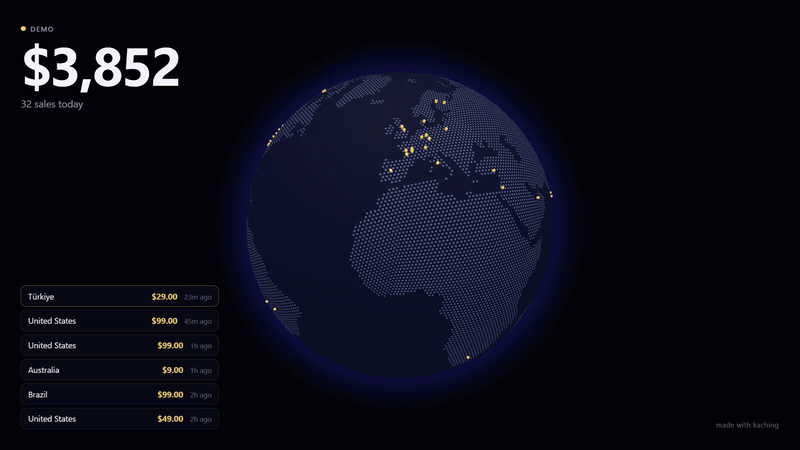

# kaching

**Your sales, live on a 3D globe.** Every payment ripples where your customer is, the total counts up, and a cash register rings. Put it on the office TV, or stream your launch day with it.



- **Stripe in one env var.** It polls with a read-only key, so there's no webhook to register.
- **Made for streaming.** `?obs=1` gives a transparent background for an OBS browser source.
- **Private by default.** It sends no names, emails, cities or Stripe ids to the browser. Dots are scattered inside the country, and amounts can be stripped on the server.
- **Works without a key.** Demo mode plays fake sales so you can see it (and record it) right away.

## Quick start

```bash
git clone https://github.com/moatezLita/kaching.git && cd kaching
npm install
npm run dev
```

Open http://localhost:3000 and you'll see the demo. Click **Turn on sound**. No Stripe account needed to try it.

### Connect Stripe

1. In the Stripe dashboard, go to **Developers → API keys → Create restricted key**. Give it **Charges: Read** and nothing else.
2. Create `.env.local`:

   ```bash
   STRIPE_SECRET_KEY=rk_live_...
   GLOBE_TOKEN=some-long-random-string   # required in production
   KACHING_HQ=48.85,2.35                 # optional: arcs fly to your HQ
   ```

3. Open `http://localhost:3000/?key=some-long-random-string`.

A test-mode key (`rk_test_...`) works too, and is the easiest way to watch it react: make a test payment and it shows up within ~3 seconds.

## URL options

| Param | Effect |
|---|---|
| `key=<GLOBE_TOKEN>` | Required to see real sales once `GLOBE_TOKEN` is set |
| `obs=1` | Transparent background, for OBS / streaming overlays |
| `sound=1` | Try to start sound without a click (works in OBS, most browsers block it) |
| `amounts=0` | Hide amounts on screen (the server still sends them; use `SHOW_AMOUNTS=false` to stop that) |
| `hud=0` | Globe only, no counter or feed |
| `brand=0` | Hide the "made with kaching" credit |
| `demo=1` | Force demo data, even with a Stripe key set |
| `rate=slow\|fast` | Demo pace. `fast` is good for recording clips |

### OBS

Add a **Browser** source with the URL `https://your-deploy/?key=...&obs=1&sound=1`, size 1920×1080. Tick **Control audio via OBS** so the ka-ching goes into your stream mix.

## Privacy and security

The globe shows your revenue, so it should be treated as private.

- With a Stripe key set, the stream **refuses to run in production without `GLOBE_TOKEN`**, and only opens for `?key=<GLOBE_TOKEN>`.
- Each sale sent to the browser carries only a country, a scattered point inside it, the amount and the currency. It never includes customer names, emails, cities, or Stripe object ids (ids are hashed).
- `SHOW_AMOUNTS=false` strips amounts on the server. The globe then shows dots and a sale count.
- Use a **restricted** key with Charges: Read only. kaching never writes to Stripe.

## Deploy

It's a plain Next.js app, so `npm run build && npm start` works on any Node 20+ host (Docker, Fly, Railway, a VPS).

**Vercel** works too. The stream is a long-lived function. It ends itself before 300 s and the browser reconnects instantly, catching up on anything it missed. If your plan has a shorter limit, the reconnect still covers it.

## How it works

```
Browser ──EventSource──▶ /api/stream ──every 3 s──▶ Stripe charges.list (last 2 min)
   ▲                         │
   └── hello · backfill · sale · bye ◀┘
```

- On connect, the server sends today's charges (`backfill`), then polls the last two minutes every 3 seconds and sends only charges it hasn't seen.
- A charge counts once it's `paid` and `succeeded`. Its location comes from the billing country, falling back to the card's country.
- Totals use the currency most of your sales are in. Other currencies are listed beside it.
- The counter resets at your local midnight.

Each open viewer runs its own poll, which is about 20 Stripe reads a minute. That's well within Stripe's limits for a few screens.

## Develop

```bash
npm test          # unit tests (node:test)
npm run typecheck
```

The code is small:

- `lib/sale.ts` turns a Stripe charge into a browser-safe sale.
- `lib/sources/` holds the Stripe and demo feeds.
- `app/api/stream/route.ts` is the SSE stream.
- `components/GlobeCanvas.tsx` is the globe ([globe.gl](https://github.com/vasturiano/globe.gl)).
- `lib/sound.ts` synthesises the ka-ching with Web Audio.

## Roadmap

- [ ] Polar, Lemon Squeezy, Gumroad and Paddle sources
- [ ] Stripe webhooks as an alternative to polling (catches delayed payment methods like SEPA debit)
- [ ] City-level placement (opt-in)
- [ ] Milestone moments: first sale of the day, new record, $10k day
- [ ] Themes and sound packs
- [ ] One-click deploy buttons (Vercel, Railway)

Ideas and PRs welcome. New payment sources are a good first contribution: implement `SaleSource` in `lib/sources/`.

## License

MIT. Map data: [Natural Earth](https://www.naturalearthdata.com/) via [world-atlas](https://github.com/topojson/world-atlas). Country data: [mledoze/countries](https://github.com/mledoze/countries).
